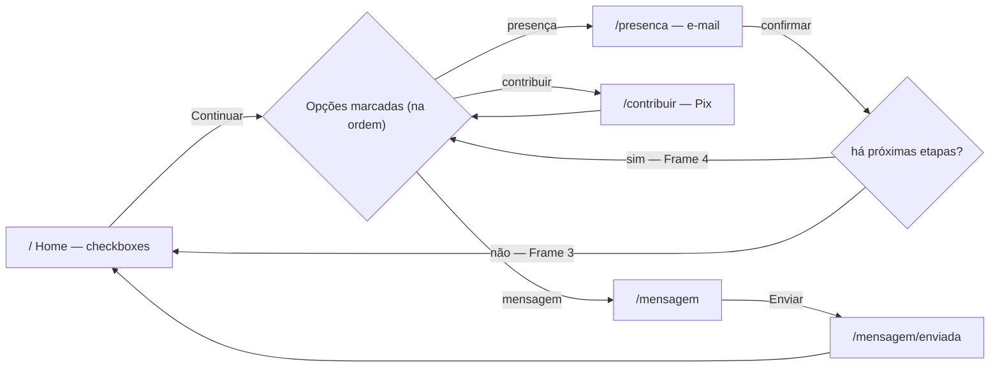

# Análise de Design — Chá de Casa Nova

Fonte: Figma `w93Fely3wvFygnUAvkAZxc` ("Untitled"), página única **Page 1** (`0:1`).
Levantamento feito via Figma MCP (`get_metadata`, `get_screenshot`, `get_design_context`, `get_variable_defs`).

> **Resumo:** o arquivo descreve um **site-convite de Chá de Casa Nova** (Sofia e João, evento em 23/01/2027, Belo Horizonte), e não um formulário genérico de inscrição em projeto. Contém 7 telas públicas (desktop, 1920 px) e 1 modelo de e-mail. **Não há telas administrativas nem versões mobile/tablet.**

---

## 1. Inventário de frames

| Frame (id) | Tamanho | Papel | Rota proposta |
|---|---|---|---|
| Frame 1 (`3:51`) | 1920×1989 | Página inicial / convite + escolha de participação | `/` |
| Frame 2 (`8:2`) | 1920×1495 | Formulário de confirmação de presença (e-mail) | `/presenca` |
| Frame 4 (`8:71`) | 1920×1444 | Sucesso da presença **com mais etapas pendentes** (botão "continuar") | `/presenca/confirmado` |
| Frame 3 (`8:47`) | 1920×1304 | Sucesso da presença **como etapa final** ("Retornar para página inicial") | `/presenca/confirmado` |
| Frame 5 (`8:82`) | 1920×1772 | Contribuição via Pix (QR Code) | `/contribuir` |
| Frame 7 (`11:27`) | 1920×1644 | Formulário de mensagem | `/mensagem` |
| Frame 8 (`11:40`) | 1920×1254 | Agradecimento pela mensagem | `/mensagem/enviada` |
| Frame 6 (`9:2`) | 800×1200 | **Modelo do e-mail de convite** enviado após confirmar presença | — (template de e-mail) |
| `10:14` | 60×60 | Ícone de pata solto no canvas (não usado em tela) | — |

Frames 3 e 4 têm o mesmo texto; a diferença é o botão. Interpretação: o Frame 4 aparece quando o convidado marcou outras opções na home e ainda há etapas; o Frame 3 encerra o fluxo.

## 2. Fluxo de navegação

As três opções da home são **checkboxes** (multi-seleção), o que implica um assistente sequencial. O Frame 5 só tem "Retornar para página inicial"; se "mensagem" também foi marcada, proponho trocar o rótulo para "continuar" (mesmo padrão do Frame 4).

## 3. Conteúdo e campos por tela

**Home (Frame 1)** — hero com foto do casal (overlay marrom), subtítulo "Você está convidado para o nosso", título "CHÁ DE CASA NOVA"; faixa cinza com texto de boas-vindas, "Data: 23 de Janeiro de 2027" e duas ilustrações azuis (flor à esquerda, ramo à direita, rotacionado −15,29°); faixa azul com "Podemos contar com você? ♡", três checkboxes com título + descrição e botão "Continuar".

**Presença (Frame 2)** — título "Que alegria ter você com a gente! ♡", texto explicativo, **campo único: `e-mail`**, texto "Estamos ansiosos…", botão "confirmar". *Não existe campo de nome.*

**Contribuição (Frame 5)** — texto sobre Pix, faixa cinza com **placeholder "QR CODE"** (351×350), agradecimento e botão de retorno. Não há chave Pix copiável nem valor.

**Mensagem (Frame 7)** — título "Seu carinho também faz parte dessa história! ♡", texto, **campo único: `Mensagem`** (textarea 933×145), botão "Enviar". *Sem nome nem e-mail do autor.*

**E-mail de convite (Frame 6)** — cartão creme com ícone de casa, "Que bom que você vem! ♡", texto, horário **11h00**, endereço **Av Saranhema, 1727 — Guarani, Belo Horizonte - MG**, **placeholder "Botar o google maps do endereço"**, assinatura "Com carinho, Sofia e João e Pepé" + ícone de pata.

## 4. Tokens visuais

Nenhuma variável/estilo do Figma está definida (`get_variable_defs` vazio); os valores abaixo vêm das camadas.

### Cores
| Token | Valor | Uso |
|---|---|---|
| `brand-blue` | `#4365BF` | fundo das seções principais, texto dos botões, ilustrações |
| `brand-blue-alt` | `#4263BB` | título do e-mail (variação mínima — unificar em `#4365BF`) |
| `surface-gray` | `#D9D9D9` | faixas, botões, inputs, rodapé |
| `cream` | `#E8E2D7` | cartão do e-mail |
| `brown-text` | `rgba(71,49,40,0.74)` | texto sobre a faixa cinza |
| `hero-overlay` | `rgba(71,49,40,0.47)` | overlay da foto |
| `white` | `#FFFFFF` | texto sobre azul e hero |
| `accent-yellow` | (miolo da flor, ~`#F5C04A`) | apenas na ilustração |

Atenção à acessibilidade: o placeholder azul sobre `#D9D9D9` e o texto marrom a 74% de opacidade precisam de verificação de contraste (WCAG AA); se ficarem abaixo de 4.5:1, escurecer levemente sem alterar a identidade.

### Tipografia
Fonte única: **Hubballi** (Regular 400, Google Fonts), `line-height: normal`.

| Papel | Desktop (px) |
|---|---|
| Título hero "CHÁ DE CASA NOVA" | 128 (letter-spacing amplo) |
| Subtítulo hero | 64 |
| Títulos de seção ("Podemos contar…", "Que alegria…") | 48 |
| Texto de corpo / rótulos de opção / botões | 36–40 |
| Descrições das opções | 20 |
| E-mail: corpo 26, horário 40, endereço 32, assinatura 24/32 |

Todos os textos são centralizados, exceto os rótulos das opções (alinhados à esquerda ao lado do checkbox) e a assinatura do e-mail (à direita).

### Formas e espaçamento
- Botões e inputs: fundo `#D9D9D9`, **raio 25 px**, altura ~81–94 px, texto `#4365BF` 36–40 px, sem borda/sombra.
- Checkbox: quadrado de 33 px com contorno branco, cantos arredondados (vetor `3:128`).
- Cartão do e-mail: raio 50 px, sombra `8px 23px 18.5px rgba(0,0,0,0.25)`.
- Coluna de conteúdo: ~870–1020 px centralizada no canvas de 1920 px.
- Hero: 791 px na home, 468 px nas demais telas.
- Rodapé: faixa `#D9D9D9` vazia (132–562 px).

## 5. Componentes reutilizáveis

`HeroHeader` (variantes `full` e `compact`), `Section` (`blue` / `gray`), `PillButton`, `PillInput`, `PillTextarea`, `OptionCheckbox` (título + descrição), `SiteFooter`, `DecorativeIllustration` (flor, ramo), `QrCodeBox`, `Heart` (♡ textual).

## 6. Estados não desenhados (a definir na implementação, mantendo a identidade)

Hover/focus/disabled/loading de botões e inputs; checkbox marcado; mensagens de erro de validação; erro de rede; botão "Continuar" sem nenhuma opção marcada; layouts mobile e tablet; aviso de privacidade (LGPD) junto aos formulários.

## 7. Divergências entre o Figma e a especificação

1. **Não há telas administrativas** no Figma (login, listagem, detalhe).
2. O "formulário de inscrição" é, na prática, **dois formulários**: presença (só e-mail) e mensagem (só texto).
3. O Figma promete **envio de e-mail** com o convite (Frames 3, 4 e 6) — exige um provedor SMTP, não previsto na stack.
4. Os status sugeridos (Pendente / Em análise / Aprovado / Recusado) não correspondem a um RSVP.
5. Placeholders a substituir por dados reais: **QR Code Pix** e **mapa do endereço**.
6. A foto do hero e as ilustrações são assets do Figma; as URLs fornecidas pelo MCP expiram em 7 dias e precisam ser baixadas para o repositório.

---

## 8. Decisões tomadas com os anfitriões (após a análise)

| Ponto em aberto | Decisão | Onde está no código |
|---|---|---|
| Telas administrativas inexistentes | Criadas no mesmo estilo: faixa com o título, abas de filtro com contagem, tabela no cartão creme do Frame 6, detalhe em diálogo creme | `frontend/src/pages/admin`, `components/admin` |
| Campos dos formulários | Nome + e-mail (obrigatório e único) na presença e na mensagem. O e-mail impede confirmar presença duas vezes | `backend/internal/services/registration_service.go` |
| Status | Não há status. O painel mostra o que cada pessoa escolheu (presença, contribuição, mensagens) | `ChoiceBadges.tsx` |
| Mensagens | Gravadas e exibidas no painel, como texto puro | tabela `messages` |
| E-mail do convite | Enviado se houver SMTP configurado; sem SMTP, o link pessoal aparece no detalhe do convidado | `services/mailer.go` |
| Mapa | E-mail não aceita iframe, então o convite (Frame 6) vira a página `/convite/<token>` com o embed do Google Maps. O endereço vem da API só para quem tem o token, e não fica no código público | `InvitePage.tsx`, `GET /api/v1/invites/:token` |
| QR Code Pix | Ainda não existe: espaço reservado com aviso. `VITE_PIX_QR_IMAGE`/`VITE_PIX_KEY` ativam imagem e botão de copiar | `ContributePage.tsx` |

## 9. Ajustes de acessibilidade em relação ao Figma

- Placeholder dos campos: `#4365BF` a 60% (Figma) tem contraste ≈2,2:1. Usamos 75% e o texto digitado em `#2F4A99` (≈6:1 sobre `#D9D9D9`).
- Texto dos botões nunca fica abaixo de 24 px (texto grande, onde 3,9:1 de azul sobre cinza atende AA).
- Rótulos dos campos existem para leitores de tela (o visual continua sendo o placeholder do Figma).
- Erros de validação usam o amarelo do miolo da flor (`#F5C04A` / `#FFE7A8`), que contrasta com o azul.
- Botão "Retornar" do Frame 5 vira "continuar" quando ainda há a etapa de mensagem (mesmo padrão do Frame 4).

## 10. Responsividade

O Figma só tem desktop (1920 px). Todas as medidas foram convertidas em `clamp()` proporcional à largura de 1920 px (ex.: título 128 px → `clamp(2.6rem, 6.67vw, 8rem)`), com mínimos legíveis no celular. A tabela do painel vira lista de cartões abaixo de 768 px. Comparação visual feita com capturas em 1920×1080 e 390×844.
